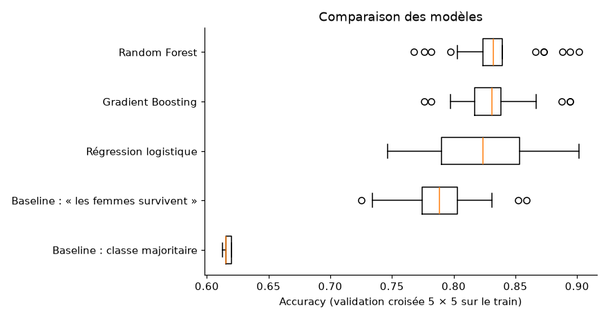
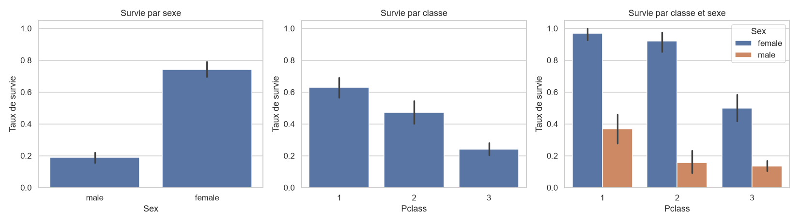
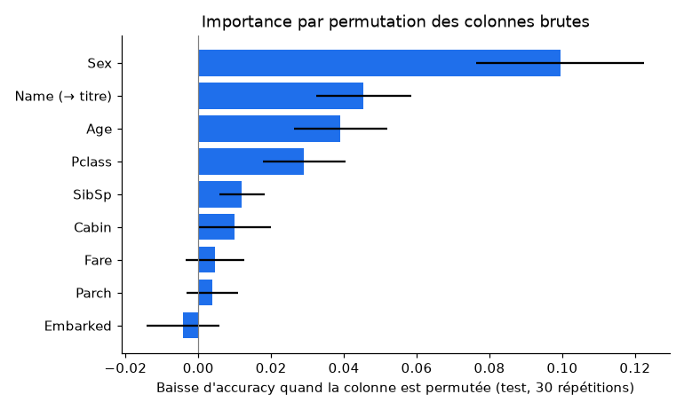
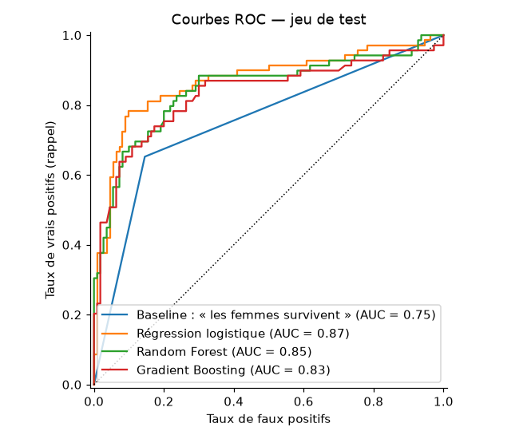
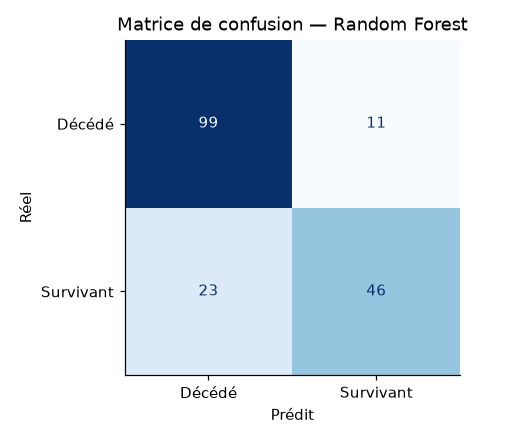

# Titanic — Prédiction de la survie des passagers

   

Projet de **classification binaire** de bout en bout : analyse exploratoire, ingénierie des variables, comparaison de modèles avec validation croisée, évaluation honnête sur un jeu de test réservé et interprétation des résultats.

> **Question :** à partir des informations du billet et de l'identité d'un passager, peut-on prédire s'il a survécu au naufrage du Titanic (15 avril 1912) ?

## Résultats en bref

| Modèle | Accuracy CV (5 × 5) | Accuracy test | ROC-AUC test |
|---|---|---|---|
| Baseline : classe majoritaire (« personne ne survit ») | 0,617 ± 0,003 | 0,615 | 0,500 |
| Baseline : « les femmes survivent » | 0,789 ± 0,032 | 0,777 | 0,753 |
| Régression logistique | 0,826 ± 0,042 | **0,849** | **0,867** |
| **Random Forest** (modèle retenu) | **0,834 ± 0,034** | 0,810 | 0,846 |
| Gradient Boosting | 0,833 ± 0,030 | 0,804 | 0,832 |

- **Modèle retenu : Random Forest** (300 arbres, profondeur 8), choisi sur la validation croisée du jeu d'entraînement.
- **Accuracy test : 0,810**, intervalle de confiance à 95 % (bootstrap) : **[0,749 ; 0,866]**, soit +3,3 points par rapport à la meilleure règle simple.
- Les trois modèles se valent : leurs écarts (< 1 point en validation croisée) sont bien inférieurs à la variabilité d'un pli à l'autre. Sur le test, la régression logistique fait mieux, mais l'écart n'est pas significatif (test de McNemar, p = 0,14). **Le modèle n'a pas été changé après consultation du test** (voir [Méthodologie](#méthodologie)).

<p align="center"></p>

## Ce que disent les données

<p align="center"></p>

- **Le sexe est le facteur dominant** : 74 % des femmes ont survécu, contre 19 % des hommes (« les femmes et les enfants d'abord »).
- **La classe module cet effet** : 97 % des femmes de 1re classe ont survécu, contre 50 % en 3e classe.
- **Les enfants** de 13 ans ou moins ont un taux de survie de 59 %. Le titre « Master » (jeunes garçons) en est un bon indicateur : 57 % de survie, contre 16 % pour les « Mr ».
- **La taille de la famille** a un effet non monotone : les passagers seuls (30 %) et les grandes familles (5 personnes et plus) survivent moins que les familles de 2 à 4 personnes (55 à 72 %).
- **Le port d'embarquement** semble lié à la survie (Cherbourg), mais l'effet disparaît une fois la classe connue : 51 % des passagers de Cherbourg voyageaient en 1re classe. C'est un effet de confusion.

<p align="center"></p>

## Méthodologie

1. **Partition** : 80 % entraînement (712 passagers) / 20 % test (179), stratifiée sur la cible. Le test n'est consulté qu'une fois, à la fin.
2. **Ingénierie des variables** (`src/titanic/features.py`), intégrée au `Pipeline` scikit-learn :

   | Variable | Construction |
   |---|---|
   | `Title` | Extrait du nom (Mr, Mrs, Miss, Master, Rare) |
   | `Age` | Valeurs manquantes (20 %) imputées par l'âge médian du titre, **appris sur le train uniquement** |
   | `IsChild` | Âge < 14 ans |
   | `FamilySize`, `IsAlone` | `SibSp + Parch + 1` |
   | `LogFare` | `log(1 + Fare)` (tarif très asymétrique) |
   | `HasCabin`, `Deck` | Cabine renseignée, lettre du pont |

   Toutes les quantités apprises (âge médian par titre, médianes, modalités) sont estimées dans `fit`, donc recalculées dans chaque pli de validation croisée : **aucune fuite d'information**.
3. **Modèles** : deux baselines, puis régression logistique, Random Forest et Gradient Boosting. Hyperparamètres optimisés par `GridSearchCV` en **validation croisée stratifiée répétée 5 × 5** (grilles dans `params.yaml`).
4. **Sélection** sur la moyenne de validation croisée, puis **évaluation finale** sur le test : accuracy, précision, rappel, F1, ROC-AUC, Brier et intervalle de confiance bootstrap.
5. **Interprétation** : importance par permutation (modèle retenu), coefficients et odds ratios (régression logistique), analyse des erreurs.

<p align="center">
  
  
</p>

**Analyse des erreurs.** La moitié des erreurs du modèle (17 sur 34) sont des hommes ayant survécu que le modèle prédisait décédés ; 10 concernent des femmes de 3e classe, dont le sort était proche d'un tirage à pile ou face. Ces cas dépendent de facteurs absents des données (position au moment du naufrage, accès aux canots).

## Structure du projet

```
titanic-survival-prediction/
├── data/raw/titanic.csv          # données Kaggle (891 passagers) + data/README.md
├── notebooks/
│   ├── 01_eda.ipynb              # analyse exploratoire
│   └── 02_modeling.ipynb         # modélisation, McNemar, coefficients, erreurs
├── src/titanic/
│   ├── data.py                   # chargement, contrôles, partition
│   ├── features.py               # ingénierie des variables (transformateur scikit-learn)
│   ├── models.py                 # baselines et modèles candidats
│   ├── evaluate.py               # métriques, IC bootstrap
│   ├── train.py                  # optimisation, sélection, évaluation, figures
│   └── predict.py                # prédictions sur un nouveau fichier (format Kaggle)
├── tests/                        # 12 tests (données, variables, modèle, prédictions)
├── models/metrics.json           # résultats complets (le modèle .joblib est régénéré)
├── reports/figures/              # figures du README
├── params.yaml                   # graine, partition, grilles d'hyperparamètres
└── Makefile · requirements.txt · pyproject.toml · .github/workflows/ci.yml
```

## Reproduire les résultats

```bash
git clone https://github.com/<wahibmahamoudhassan>/titanic-survival-prediction.git
cd titanic-survival-prediction
python -m venv .venv && source .venv/bin/activate     
pip install -r requirements-dev.txt

make train      #  métriques (models/metrics.json) et figures
make test      
make notebook   
```

Sans `make` (Windows) : `set PYTHONPATH=src` puis `python -m titanic.train` et `python -m pytest`.

**Soumission Kaggle** : télécharger `test.csv` depuis la compétition, puis

```bash
make predict INPUT=test.csv     
```

## Limites et pistes

- Petit jeu de données (891 passagers) : l'incertitude sur les scores est d'environ ± 6 points d'accuracy sur le test.
- La variable `Ticket` n'est pas exploitée ; le partage de billet (groupes voyageant ensemble) est une piste d'amélioration connue.
- Pistes : groupes familiaux par nom de famille et billet, stacking de modèles, calibration des probabilités, interprétation locale avec SHAP.

## Données et licence

Données : compétition Kaggle [Titanic — Machine Learning from Disaster](https://www.kaggle.com/c/titanic). Code sous licence MIT.
